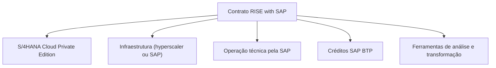

# RISE with SAP - Study

> Nível: noção
> O pacote comercial que entrega o S/4HANA Cloud Private Edition, a infraestrutura, a operação e o SAP BTP num contrato só. Estudo de leitura, sem prática no trial. Relacionados: [Cloud Private Edition](https://github.com/igor-barral/SAP-S4HANA-Cloud-Private-Edition-erp-study), [GROW with SAP](https://github.com/igor-barral/GROW-with-SAP-erp-study), [SAP ECC](https://github.com/igor-barral/SAP-ECC-erp-study), [SAP S/4HANA (índice da fase 0)](https://github.com/igor-barral/SAP-S4HANA-erp-study).

## Objetivo

Entender o que é o RISE with SAP o suficiente para interpretar uma vaga ou uma conversa de projeto que diga "cliente RISE". RISE não é um produto técnico nem uma ferramenta: é uma **oferta comercial** (lançada em 2021) com a qual a SAP propõe levar os clientes, principalmente os de ECC, para o S/4HANA em nuvem. Para o desenvolvedor, o que importa é o que o contrato muda no dia a dia: quem opera o sistema e que expectativa existe sobre o código.

Ao concluir este estudo você deverá ser capaz de responder perguntas como:

- O que o cliente compra ao assinar o RISE?
- Qual a relação entre RISE e S/4HANA Cloud Private Edition?
- Por que a SAP oferece o RISE aos clientes ECC?
- O que muda para a equipe de desenvolvimento num projeto RISE?

---

## Ponte

| No que eu já conheço | No RISE |
|---|---|
| Contrato "tudo incluído" de um fornecedor de ERP: licença, hospedagem, suporte e atualização numa mensalidade | RISE: ERP, infraestrutura, operação técnica e ferramentas numa assinatura |
| Cliente que sai do servidor próprio para um SaaS ou hosting gerenciado | Cliente que sai do ECC on-premise para a Private Edition operada pela SAP |
| Créditos de nuvem incluídos no plano para usar serviços adicionais | Créditos de SAP BTP incluídos para extensões e integrações |

---

## Conteúdo

### O que vem no pacote

A composição exata muda com o tempo e com a negociação; a estrutura geral é:

| Componente | O que é |
|---|---|
| ERP | SAP S/4HANA Cloud Private Edition (o núcleo do pacote) |
| Infraestrutura | Hyperscaler escolhido (ou data center da SAP), já incluído |
| Operação técnica | Serviços gerenciados de Basis, banco, backup e disponibilidade, conforme o documento de papéis e responsabilidades |
| SAP BTP | Créditos para extensões, integrações e automação |
| Ferramentas de transformação | Análise de processos e de preparação para a migração (por exemplo, SAP Readiness Check e ofertas de análise de processos da SAP) |
| Rede de negócios | Acesso inicial à SAP Business Network (confirme o escopo no contrato) |

O modelo de preço é por assinatura, baseado no uso do ERP (métrica de usuários equivalentes; confirme a métrica e os termos com a SAP). Não há preço público de referência.

### Por que a SAP oferece o RISE aos clientes ECC

- O ECC sai da manutenção padrão no fim de 2027, e a SAP quer que a migração seja para a nuvem, não só para o S/4HANA on-premise.
- O RISE reduz o número de contratos e fornecedores que o cliente precisa gerenciar.
- A Private Edition aceita **conversão** (*brownfield*), então o cliente pode levar o sistema e o código existentes, ao contrário da Public Edition.
- A SAP ofereceu condições de transição ligadas ao RISE, inclusive uma opção de manter o ECC operado pela SAP por um período maior antes da conversão. Os termos dessas opções devem ser confirmados na documentação oficial.

### O que muda para a equipe de desenvolvimento

| Tema | Projeto on-premise clássico | Projeto RISE |
|---|---|---|
| Basis | Equipe do cliente ou do parceiro | Em boa parte da SAP; pedidos por canal de serviço |
| Acesso a SO e banco | Possível | Não |
| Código novo | Livre | ABAP Cloud e Clean Core como expectativa |
| Código herdado do ECC | Mantido como está | Ajustado na conversão e acompanhado como débito técnico |
| Extensões fora do núcleo | Opcional | Estimuladas, com créditos de BTP já contratados |
| Upgrades | Quando o cliente quiser | Planejados, com releases suportadas |

Em resumo: o desenvolvimento em si é o mesmo da Private Edition; o RISE traz uma governança mais explícita sobre Clean Core e um parceiro operacional (a SAP) com quem as janelas e mudanças técnicas precisam ser combinadas. Ver [SAP-S4HANA-Cloud-Private-Edition-erp-study](https://github.com/igor-barral/SAP-S4HANA-Cloud-Private-Edition-erp-study).

### RISE e GROW

RISE é o pacote para grandes empresas e para quem vem de ECC, centrado na Private Edition. GROW é o pacote equivalente da Public Edition, voltado a médio porte e implantações novas. Comparação em [GROW-with-SAP-erp-study](https://github.com/igor-barral/GROW-with-SAP-erp-study).

---

## Respostas

**O que o cliente compra ao assinar o RISE?**
Uma assinatura que junta o S/4HANA Cloud Private Edition, a infraestrutura, a operação técnica pela SAP, créditos de SAP BTP e ferramentas de análise e transformação, num único contrato.

**Qual a relação entre RISE e Private Edition?**
A Private Edition é o ERP que o RISE entrega. RISE é o contrato; a Private Edition é o sistema.

**Por que a SAP oferece o RISE aos clientes ECC?**
Porque o fim da manutenção do ECC obriga uma decisão, e o RISE oferece um caminho para a nuvem que aceita conversão do sistema existente, reduz o número de contratos e inclui operação e ferramentas.

**O que muda para a equipe de desenvolvimento?**
O código continua sendo S/4HANA completo, mas sem acesso administrativo ao SO e ao banco, com Basis em boa parte da SAP, upgrades planejados com ela e Clean Core como expectativa: ABAP Cloud para código novo, modificações controladas e extensões no BTP.

---

## Referências

- SAP (página do produto): https://www.sap.com (buscar "RISE with SAP")
- SAP Learning: https://learning.sap.com (buscar "RISE with SAP")
- SAP Community: https://community.sap.com (buscar "RISE with SAP roles and responsibilities")
